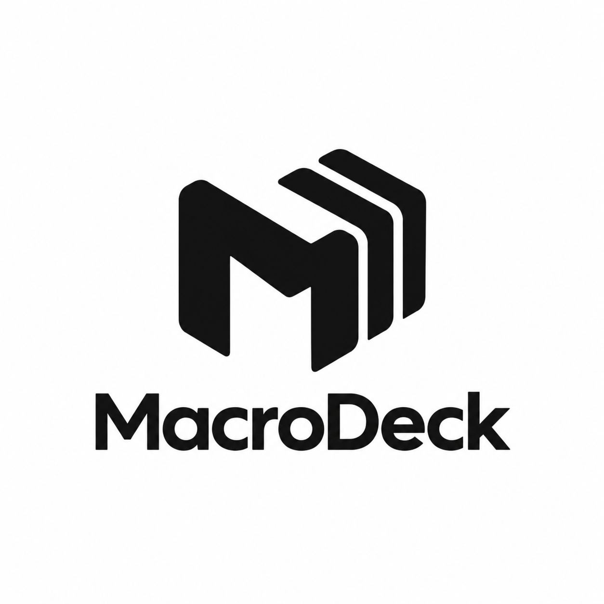

# MacroDeck

[English](README.md) · [Português (Brasil)](README.pt-BR.md)

Gravador e reprodutor de macros para Windows.

## Créditos

Desenvolvido por [shamanss07](https://github.com/shamanss07), com assistência do ChatGPT (OpenAI) na implementação e revisão do projeto.



## Recursos

- Grava e reproduz ações de teclado e mouse.
- Permite testar uma gravação antes de salvá-la e organizar macros em arquivos JSON.
- Oferece atalhos globais configuráveis, repetição e intervalo entre ciclos.
- Inclui temas claro e escuro, personalização de cores e seleção de fontes instaladas.
- Mantém as preferências do usuário entre execuções.
- Permite escolher Português (Brasil) ou Inglês para a interface em **Menu → Opções**, sem reiniciar. Na primeira execução, usa inglês quando o idioma de interface do Windows é inglês; nos demais casos, usa português.
- Inclui uma área reservada para o desenvolvimento futuro do Auto-Clicker.

## Compatibilidade

O suporte inicial é **somente para Windows**. O programa foi desenvolvido em C# com Windows Forms e requer o **.NET Framework 4.8**. Linux e macOS não são suportados nesta versão.

## Instalação e uso

Baixe `MacroDeck-1.1.1.exe` na seção **Releases** do GitHub e execute-o no Windows. Se o .NET Framework 4.8 não estiver instalado, o Windows poderá solicitar sua instalação.

1. Escolha a pasta onde os macros serão guardados.
2. Informe um nome e clique em **Gravar**; o atalho padrão é F9.
3. Clique em **Gravar** novamente ou pressione F9 para parar.
4. Clique em **Reproduzir** para testar a gravação, ou em **Salvar gravação** para guardá-la.
5. Selecione um macro salvo e clique em **Reproduzir**; o atalho padrão é F10.

Use **Definir** para alterar um atalho; Esc cancela a captura. **Ciclo Infinito** repete a reprodução até que ela seja interrompida. Os controles de intervalo aceitam minutos e segundos.

Macros são arquivos JSON na pasta escolhida. As preferências ficam em `%APPDATA%\MacroDeck\settings.json`. Fechar o programa descarta uma gravação pendente sem perguntar.

## Compilar a partir do código

1. Instale o .NET Framework 4.8 Developer Pack no Windows.
2. Abra o PowerShell na pasta `Source`.
3. Execute:

   ```powershell
   .\build.ps1 -OutputName MacroDeck-1.1.1.exe
   ```

O executável é criado na pasta raiz do projeto. Também é possível abrir `Source/MacroDeck.csproj` no Visual Studio. A licença OFL em `Source/Assets/Fonts/OFL.txt` cobre a fonte Montserrat incluída, não o código do MacroDeck.

## Licença

O código do MacroDeck é disponibilizado sob a licença MIT, em `LICENSE`. A fonte Montserrat incluída tem licença SIL Open Font License 1.1, em `Source/Assets/Fonts/OFL.txt`.

---

Documentação em inglês: [README.md](README.md) · [Privacidade](PRIVACY.pt-BR.md) · [Guia de contribuição](CONTRIBUTING.md)
